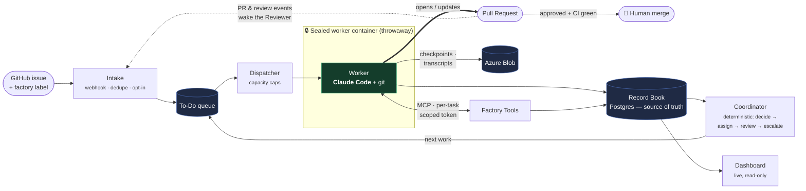
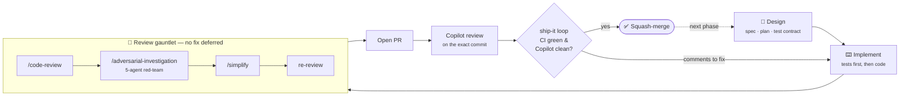

# Factory — Project Overview

*A plain-English overview of what Factory is, what we built, and how. For leadership + engineering. See also the [product spec](factory-product-spec.md), [technical spec](factory-technical-spec.md), and [implementation plan](factory-implementation-plan.md).*

## In one line

**Factory is an autonomous software team that runs itself** — you label a GitHub issue, and a fleet of AI workers triages it, writes the code *and the tests*, opens a pull request, reviews it, and hands it to a human to merge. **And Factory itself was built this way** — almost entirely by an AI agent loop, human-directed, over a few days.

> **Lineage.** Inspired by **Steve Yegge's _Gas Town_** (multi-agent orchestration — "Kubernetes for AI coding agents") and **Karpathy's** shift from "vibe coding" to **_agentic engineering_** (orchestrating agents, with humans as oversight). Factory's twist: not a swarm a human points at a task, but a **self-running team** — GitHub-wired, reacting to issues on its own, with a human always on the final merge.

---

## 1. What it is

Instead of engineers picking up tickets, writing code, reviewing each other's work, and merging, Factory does that with AI workers coordinated by a deterministic controller:

- **Work arrives** when someone adds a `factory` label to a GitHub issue (opt-in — everything else is ignored).
- **A Manager** (AI) triages it; the deterministic **Coordinator** then assigns a **Coder**.
- **Each worker runs in its own sealed, throwaway container.** The worker *is* a real AI coding assistant (Claude Code) — it explores the repo, writes the change and its tests, runs them until green, and opens a pull request.
- **A Reviewer** (AI) wakes on that PR, checks the diff and that the tests are real, then approves or requests changes (which loops back to a Coder).
- **A human performs the final merge** — the one irreversible step, kept under human control.
- **Nothing is lost.** Every action is recorded durably and each session is checkpointed, so a crash *resumes the same session* rather than starting over.

---

## 2. What we built

A production-grade distributed system: a Rust workspace of **7 services + 6 shared libraries**, fully containerized and deployed on Azure.

### The moving parts

Seven long-running **services**, each doing one job and talking to the others only through the database (no service-to-service RPC to go wrong):

- **Intake** — the front door: verifies GitHub webhooks, drops anything unlabeled, de-dupes, enqueues work.
- **Dispatcher** — pulls the next task *within the capacity caps*, mints a one-time token, launches a worker.
- **Worker** — a thin harness that runs **Claude Code** in a throwaway container, shaped to the task's role (manager / coder / reviewer).
- **Tools** — the worker's only way back in: a small REST + MCP API (read task, open PR, comment, review, checkpoint, escalate), every call authenticated, audited, and idempotent.
- **Coordinator** — the *deterministic* brain (never calls a model): reacts to outcomes, decides the next step, reclaims workers that die.
- **Dashboard-API** — read-only live views, streamed to a browser.
- **Migrate** — a one-shot schema-migration job on each deploy.

Plus six libraries: `record` (Postgres data layer), `github` (webhooks + outbound client), `blob` (checkpoints & transcripts), `config` (validates each repo's `.factory/config.yml` and layers role prompts), `telemetry`, and `azure-auth` (Managed-Identity, rustls — no OpenSSL).

### How the parts fit

**One Postgres database is both the source of truth and the work queue** — no separate broker. Because everything funnels through it, the hard guarantees are enforced in one place: **no task starts twice** (atomic `FOR UPDATE SKIP LOCKED` leases), **capacity caps are never exceeded** (advisory locks, not best-effort counters), and **re-running a task is safe** (idempotent enqueue and outbound actions, so a retry updates the same PR). All three are proven by concurrent-load tests.

**The worker is a sealed sandbox.** Each run gets a fresh container with a repo clone and *no standing credentials* — its only channel back is the Tools API, carrying a **per-task token** scoped to that one task and **revoked when it ends**. The AI writes code freely inside its box but reaches the outside world only through a narrow, audited door.

**Durability.** A worker's full session is continuously **checkpointed to Azure Blob**; if it (or the Coordinator) dies, the next dispatch **resumes the exact same session** (`claude --resume`). A **lease sweeper** reclaims silent workers, and everything is **bounded** — retries, the review↔rework loop, and per-run wall-clock all have caps; when one is hit, Factory **escalates as a comment on the issue** rather than looping forever.

### Running on Azure

Described as code (**Bicep**), in a single resource group:

- **Container Apps** run the services; a **Container Apps Job** runs *one execution per worker task* — scales to many parallel jobs, costs nothing idle.
- **Postgres Flexible Server**, **Blob** (30-day lifecycle), **Key Vault**, **Log Analytics**.
- **Least privilege:** each service has its own **Managed Identity** with only the roles it needs; deploys run via **GitHub Actions + OIDC** — no stored cloud credentials.
- **Local parity:** the same images run locally on `docker-compose` against Postgres + the **Azurite** Blob emulator.

It's **proven end-to-end on real Azure** — a labeled issue drove the full loop (Manager → Coder → Reviewer → ready-for-merge) into a real reviewed PR.

---

## 3. How we built it

**The discipline**

- **Spec first** — product spec (the contract) → technical spec (every tech choice questioned) → phased plan.
- **Design → tests → code** — the entire end-to-end suite was written up front as stubs; each phase un-ignores the tests it owns, so stubs-remaining *is* the burndown.
- **Local-first** — every external system (GitHub, git, Claude, the launcher, Blob) sits behind a seam with a fake, so CI exercises the whole system without live credentials.
- **Hard gates** — `clippy -D warnings`, enforced formatting, no `unwrap` in prod, telemetry on every path.

**The process — built largely by an AI loop, human-directed.** Each phase ran the same pipeline:

The **review gauntlet** is the heart of it: `/code-review` scans the diff from many angles; **`/adversarial-investigation`** runs a 5-agent red-team that must reach consensus on every finding, each backed by a receipt (it repeatedly caught bugs the first pass missed); `/simplify` deletes and compacts. Then **Copilot** reviews the PR, and an autonomous **ship-it** loop (a cron-driven agent swarm) fixes every comment, re-runs the gates, and merges only when CI is green *and* Copilot's review of the exact commit is clean.

**No fix is ever deferred** — every finding is resolved and re-reviewed in the same pass, since the most common source of a new bug is the previous fix. The human (Pedram) directed — product and tech-choice calls, answering the agents, approving merges — while the agents implemented and reviewed. The toolchain even built *itself*: the `implement-e2e` loop and the ship-it Copilot gate shipped as their own reviewed PRs. **Result: two dozen+ PRs, each through the full gauntlet, from empty repo to running live on Azure.**

---

## 4. Where it is now

- **The system is complete** — built, tested, and **proven live end-to-end on Azure**, with hardened, repeatable deploy + CD.
- **Biggest open lever: the prompts.** The manager/coder/reviewer run on first-pass **default prompts**, and output is only as good as they are — the clearest next investment is iterating on them (especially the **code-review** prompt) and *hill-climbing* them against real runs.
- **Deliberate v1 descopes:** no chat UI, no spend cap, no prompt-injection hardening, single-region.
