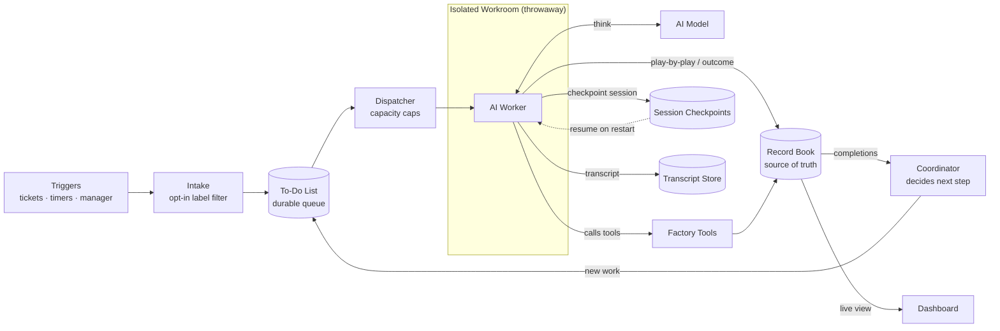

# Factory — Product Spec

*What Factory is, how it works for the people who use it, and what a good version must do — in plain English. It makes no binding technology choices. Concrete names (a `factory` label, a config file in the repo) are illustrative, not committed implementations.*

We are building an **autonomous software team that runs itself**. Instead of human engineers picking up tickets, writing code, reviewing each other's work, and merging it, a fleet of AI workers does that work — and a central **coordinator** decides who works on what, keeps track of everything, and makes sure nothing falls through the cracks.

Think of it as a **factory floor**:

- **Work arrives** from a few sources: someone (or something) opens a ticket or a change request (what some tools call a pull request — a proposed code change), a timer goes off ("run the nightly checks"), or the coordinator itself decides more work is needed.
- **A dispatcher** picks up each piece of work, checks capacity against the configured caps, and hands it to a worker.
- **Each worker runs in its own sealed workroom** — a throwaway workspace with a copy of the code and a set of tools. The worker is an AI assistant that reads the task, explores the code, makes changes, runs tests, and opens a change request — calling back to the factory for tools as it goes.
- **Everything the worker does is recorded** — a running play-by-play of its actions and the final result — into a central **record book** that is the single source of truth.
- **A Coordinator** keeps the effort moving: it tracks every ticket and change request, decides the next step, dispatches the worker that does it, and flags a human when something is genuinely blocked. It is deterministic — it never writes code and makes no AI judgments; it only decides and delegates. (Triage of a new issue — the judgment of *what* to do — is the job of a **Manager** worker, one of the AI team members below, not the Coordinator. Some workers are also event-driven — a new change request automatically wakes a reviewer.)
- **The loop closes:** the Coordinator's decisions become new work on the to-do list, the dispatcher picks them up, and so on, until the task is truly done.
- **Humans watch through a dashboard** showing what every worker is doing right now, what has finished, and the state of every ticket and change request.

One thing the factory always does keeps it healthy:

- **It never loses work.** A worker's session is checkpointed continuously, so if a worker or the coordinator restarts, half-finished jobs resume from their exact state — or restart from the to-do list if that state is lost. Nothing is left dangling.

## Onboarding a repo (the one-time setup)

Getting a repository onto Factory takes two steps, both done once:

1. **Connect the repo.** You grant Factory access to your repository — the same way you'd install any app or bot on it. This lets Factory (a) get notified whenever something happens on the repo (an issue is opened, a change request is pushed), and (b) act on the repo on your behalf: read the code, leave comments, and open change requests. Access is scoped to only the repos you connect.

2. **Describe your team (it lives in the repo).** You add one small config file to the repository itself that lists the workers you want — a manager, a coder, a reviewer, a tester — what wakes each one up (a new issue, a new change request, a nightly timer), and any limits (how many may run at once). Because this file lives in your repo, your Factory setup is version-controlled and reviewed like any other code, and Factory re-reads it automatically whenever it changes — no redeploy, no console clicking. This file *is* your team: with no config there are no workers, and Factory does nothing on the repo.

That's the whole setup. From this point on Factory watches the repo on its own. You never "start a run" — you work normally, and Factory reacts.

**One safety rule keeps you in control:** Factory only acts on work you explicitly hand it. By default it ignores everything; you opt a piece of work in by adding a label (e.g. `factory`) to an issue. Anything without that label, Factory leaves alone.

## A worked example: from a hand-written issue to a merged change

You've connected your repo and you want a bug fixed. You don't open a console or any special tool — you do exactly what you'd normally do:

1. **You open an issue by hand:** *"Login endpoint has no rate limiting — add it, with tests."* You add the `factory` label to hand it over.
2. **Factory notices** (it's watching the repo) and puts a job on the to-do list for the **Manager** — an AI worker that triages the new issue.
3. **The Manager reads the issue**, confirms it's in scope, and leaves a short comment so you can see it's been picked up; the deterministic **Coordinator**, reacting to the Manager's result, then **assigns a Coder**.
4. **The Coder wakes up in its own sealed workroom** — a fresh, throwaway copy of your repo. It reads the issue, explores the code to find the login endpoint, writes the rate-limiting change *and* its tests, runs the tests until they pass, then **opens a change request** linked to the issue and comments "ready for review."
5. **The Coder's job finishes**; its result (success, and the change request it produced) is recorded.
6. **Opening the change request is itself an event Factory reacts to** — it automatically wakes a **Reviewer** for that change request (no one has to assign it). Meanwhile the Coordinator also sees the Coder's job finish and keeps tracking the issue's progress.
7. **The Reviewer wakes up in its own workroom**, reads the diff, checks the fix is correct and the tests are real, and leaves a verdict:
   - **Requests changes** → the Coordinator hands the change request back to a Coder to address the feedback, looping to step 4 on the same change request.
   - **Approves**, and once the repo's own automated checks are green → Factory marks the change ready and **hands it to a human to merge**. Factory never merges on its own — a person performs the final merge, keeping the one irreversible step under human control.
8. **The Coordinator closes the loop** — comments the outcome (a human merges; automatic issue-closure on merge is a later capability).

Throughout, you can watch every step on the dashboard — which worker is doing what, the live play-by-play, the change request, the review — and you can leave a comment or edit the issue or change request to steer it. At most you wrote an issue and clicked merge; Factory did the rest.

## What a good version must satisfy (the requirements)

These are the requirements a good version must satisfy — the qualities to hit, regardless of how it is built. (Technology choices are made separately and are out of scope for this document.)

**Handling work reliably**

- **Nothing is lost.** Every task, and every action a worker takes, is written down durably the instant it happens, in one authoritative place. A full restart of the system picks up from those records.
- **A crash never loses work — it resumes the same session.** The worker *is* an AI coding assistant, so its session — conversation/context, working tree, in-flight tool calls, and any human inputs along the way — is checkpointed continuously and durably. When a worker or the coordinator stops for *any* reason (graceful pause, crash, or full restart), Factory resumes that *same* session from its last checkpoint rather than starting fresh. **Bounded:** repeated resumes that keep failing at the same point fall through, after a few, to a fresh attempt or escalation, so a deterministic crash can't resume-loop forever. **Fallback:** if the session state itself can't be recovered, Factory runs a *fresh* attempt of the same task — which, being safe to redo, reuses the same change request and comments instead of duplicating them.
- **Safe to redo.** Because the fallback re-runs a task from scratch, a worker must be able to repeat a task without making a mess: if last time it already opened a change request or left a comment, the redo updates the *same* one instead of creating duplicates.
- **Bounded effort, then a human.** Work is retried only a few times; if it still can't be done — or needs a human decision (a conflict, a judgment call) — the system stops and escalates with context, never looping forever or silently giving up. An escalation is delivered where a human already looks — a comment on, and assignment of, the issue or change request — not left silently on a dashboard.
- **Bounded loops, not just bounded retries.** A single issue can cycle through the review-and-rework loop (Coder → Reviewer → Coder…) only a capped number of times; when that cap is hit, the system escalates to a human rather than reworking forever. Retries bound a *failing* attempt; this bounds *successful* attempts that keep cycling. What counts toward the cap is each completed Coder→Reviewer rework cycle; time spent waiting on the reviewer's verdict does not (the same carve-out as *Needs human input*).
- **Needs human input → ask, don't block.** A worker never waits interactively for an answer (there is no live chat with a worker) or holds its slot while idle. On low-stakes, reversible ambiguity it makes a reasonable best-effort call and records the assumption on the change request so a human can correct it in review. On a high-stakes or irreversible choice it instead writes a clear question with context onto the issue or change request, records a distinct *blocked: waiting on a human* state (not failed, not done), and ends the attempt, freeing its slot. The human answers asynchronously by commenting or editing; that reply is itself an event that resumes the worker's session (with the same resume-and-fallback rules as a crash). Time spent blocked on a human does **not** count against the retry or per-issue loop caps, so a slow reply never causes the work to be abandoned.
- **Stuck workers are caught.** A worker that hangs or goes quiet is detected and cleaned up automatically, so it can't occupy a slot forever.
- **Capped and scalable.** Many repositories and many workers run at once. Capacity is capped — globally and per repository-and-worker-type — so the system never runs more than its configured limits, and it scales by adding machines rather than being rewritten.
- **No double-starts.** The same task is never started twice and two workers never collide on it — even when several coordinators run at once, or right after a restart. This is guaranteed by a single shared source of truth that arbitrates who picks up each task; it does *not* require exactly one coordinator process to be running (many may run).
- **Good work, not just any work.** A worker always starts by writing the tests first — the tests define what "done" means — and only then writes the code to make them pass. A change isn't "done" because a worker says so: it must include those tests, they must pass, it must clear the repository's own automated checks, and a review must approve it, before anything merges. The system can tell a genuinely-finished task from one it gave up on.
- **Workers genuinely good at coding — reuse, don't reinvent.** The hard requirement is competence at real coding tasks — exploring an unfamiliar codebase, making correct changes, and writing real tests — not merely producing plausible-looking diffs. The strongly-preferred way to get that competence is to drive an existing, capable AI coding assistant rather than build and maintain a bespoke agent loop.
- **Records don't pile up forever.** Everything Factory keeps — summaries, logs, finished tasks, and each run's detailed play-by-play — is held in Factory's own storage for a bounded time and then aged out, so storage stays under control.

**Staying in control (work proceeds only as a human permits)**

- **Opt-in only** (as described above): it acts only on work explicitly handed to it.
- **Least privilege.** Each worker can touch only its one repository, with credentials that are short-lived and revoked when its task ends (or when a stuck worker is reclaimed). For the first version, builds need the open internet (to fetch packages), so a worker's outbound network is *not* otherwise locked down. Factory makes a best effort to keep secrets out of what it records, but can't guarantee it — so treat anyone allowed to view a run's records as able to see whatever they captured. A worker also may not weaken or disable the automated checks that gate its own work; altering those checks is itself escalated to a human.
- **Confidential by default.** The code Factory works on, and the records Factory keeps — including each run's detailed play-by-play — are treated as confidential: shown only to the people allowed in, never used to train models, and purged after the bounded retention period above.

**Being transparent**

- **A full, debuggable play-by-play.** Everything a worker does is observable live (a running summary streams to the dashboard, an eventually-consistent live view — see "Fresh view") and after the fact: the *complete* transcript of each run — including the assistant's own session log — is kept in Factory's own storage, organized by the issue or change request it belongs to and linked from that issue or change request, so you can open exactly what happened without leaving your normal workflow. There's also an audit trail of who and what did each thing.

**How well and how fast (directional targets, not exact numbers)**

- **Prompt pickup.** Once work is handed over, a worker should start on it within minutes, not hours.
- **Always on.** The coordinator should stay available continuously; one machine failing shouldn't stop the factory.
- **Comfortable scale.** It should handle many repositories and dozens of workers at once, and grow by adding machines.
- **Fresh view.** The dashboard reflects recorded state within seconds — an eventually-consistent view, close enough to live to act on, not a to-the-millisecond guarantee.

## What we are deliberately NOT building (first version)

- A chat interface for humans to converse with the workers.
- Workers that do anything other than software tasks.
- Strong walls between mutually distrusting tenants — we assume the code being worked on is trusted. (We also accept that text in an issue or change request is author-controlled, and that a worker driven by it holds repository credentials — hardening against that "prompt-injection" risk is not in the first version.)
- **Spending limits.** A hard cost ceiling that automatically pauses work when the AI spend crosses a budget is *not* in the first version. Runaway effort is still bounded (time limits, retry caps, and the per-issue loop cap above), but money spent is not independently metered or capped. (This is a deliberate descope; a budget can be added later without redesign.)
- Surviving the loss of an entire region. The system stays available when any single machine fails, but a full regional outage stops it until recovery.

## Diagram

The flow, rendered inline:

