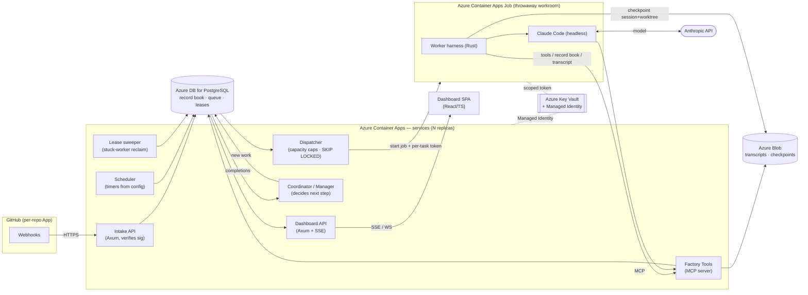

# Factory — Technical Spec

*How Factory is built. This document makes the technology choices the [product spec](factory-product-spec.md) deliberately deferred. Every requirement in the product spec maps to a concrete mechanism here (see [Requirements traceability](#requirements-traceability)). Where the product spec is the contract, this is the implementation blueprint.*

Hosting target: **everything runs on Azure, using Azure-native services.** Factory itself is written in **Rust**; each worker drives **Claude Code** (the CLI coding assistant) rather than a bespoke agent loop.

## Technology decisions

| Concern | Decision | Why |
| --- | --- | --- |
| Implementation language | **Rust** (Cargo workspace: `services/`, `libs/`) | Single static binary, runs identically on laptop and cluster; matches repo conventions (clippy/fmt gates, no `unwrap` in prod). |
| Async runtime / errors | **tokio**, **anyhow** (apps) + **thiserror** (libs) | Repo standard. |
| Coding assistant (per worker) | **Claude Code CLI**, headless, driven as a subprocess | "Reuse, don't reinvent." Native session persistence + `--resume` maps onto the crash-resume requirement; tools via MCP. |
| Model access | **Anthropic API directly** over the internet; key in Key Vault | Anthropic is not first-party on Azure; the workroom already has open egress. Model provider sits behind Claude Code config, so it stays swappable. |
| Code host | **GitHub App** (per-repo install) · **octocrab** client | Webhooks for events; short-lived **installation tokens** for least-privilege repo access; Checks/PR APIs for gating and handoff. |
| State / queue / arbitration | **Azure Database for PostgreSQL — Flexible Server** · **sqlx** | One transactional store for the record book, the durable to-do queue (`FOR UPDATE SKIP LOCKED`), and pickup arbitration. Single dependency; same engine locally. |
| Worker runtime (sealed workroom) | **Azure Container Apps Jobs** (one-shot, per task) | Throwaway by construction; scale-to-zero; managed scaling for many concurrent workers without running a cluster. |
| Session/worktree checkpoints + transcripts | **Azure Blob Storage** (lifecycle rules = bounded retention) | Cheap, scalable, native expiry. Postgres holds only pointers + state. |
| Secrets / identity | **Azure Key Vault** + **Managed Identity**; workers get short-lived, task-scoped tokens | No secrets in config; mediated, least-privilege worker access. |
| Telemetry | **OpenTelemetry** → **Azure Monitor / Application Insights** (traces, metrics) + **Log Analytics / KQL** (logs) | Vendor-neutral instrumentation, Azure-native sink. Satisfies the "log every event/decision/error" mandate. |
| Build / deploy | **Azure Container Registry** + **GitHub Actions** | Code lives on GitHub; Actions runs the Rust gates and deploys to Azure. |
| Long-lived services | **Azure Container Apps** services, **N replicas** | Always-on with replica redundancy; concurrency-safe via Postgres arbitration. |
| Dashboard | **React/TypeScript SPA** + **Rust (Axum) API**, SSE/WebSocket for live view | Rich UI; eventually-consistent stream off the record book. |
| Factory Tools (worker → Factory) | **MCP server** | Claude Code's native tool path; clean contract for read-ticket / comment / query-record-book / write-transcript. |
| Worker trust boundary | Worker reaches Factory **only** via Tools/MCP with a per-task token; **no** direct Postgres/Blob | Tightest least-privilege; every worker effect is mediated and logged. |
| Webhook intake | Direct **HTTPS endpoint → Postgres** (signature-verified) | Keeps Postgres the single source of truth; no extra broker. |
| Timers | **In-app scheduler** enqueues due work into Postgres | Schedule lives with the repo config; one system everywhere. |
| Repo config file | **YAML** (`.factory/config.yml`) | Familiar (GitHub-Actions-like), comments, readable nesting. |
| Local parity | **docker-compose** + **Azurite** (Blob emulator) + local Postgres; workers as local Docker | Same images/binaries as prod, Azure deps emulated. |

## Architecture



**Service boundaries.** All long-lived components run as Azure Container Apps services (multiple replicas). They are stateless; **all** shared state is in Postgres + Blob, so any replica can handle any request and a dying replica loses nothing. Workers run as Container Apps **Jobs** — one execution per task, destroyed on completion.

## Components

### Intake API
Axum service. Receives GitHub webhooks, verifies the HMAC signature, filters by the **opt-in label** (`factory`), and writes a work item into the Postgres to-do list inside one transaction. Returns 2xx fast; all downstream work is async off the queue. Idempotent on GitHub delivery ID (dedupes redelivered webhooks).

### Scheduler
Reads each onboarded repo's `.factory/config.yml` timer definitions and enqueues due work into Postgres. Uses a Postgres advisory lock so exactly one replica fires a given schedule tick (no duplicate nightly runs across replicas).

### Record book, queue & leases (Postgres)
Single source of truth. The to-do list is a table; the dispatcher leases rows with `SELECT … FOR UPDATE SKIP LOCKED`, which is the **no-double-starts arbitration** — it works correctly with many dispatcher replicas and after restarts, with no "exactly one coordinator" requirement. (See [Data model](#data-model).)

### Dispatcher
Polls the queue under capacity caps (global + per repo-and-worker-type, enforced as counts in SQL). For each leased task it starts a Container Apps Job execution, injecting a **per-task scoped token** and the task id. The lease has an expiry; the worker heartbeats via the Tools API to extend it.

### Coordinator / Manager
Reacts to completions in the record book and decides the next step (assign a Coder, wake a Reviewer on a new CR, hand an approved+green CR to a human, close the loop, or escalate). It only decides and delegates — it enqueues new work items; it never writes code. Runs as replicas; per-issue decisions are serialized with a row lock on the issue.

### Worker harness + Claude Code (Container Apps Job)
The throwaway workroom. The Rust harness:
1. Mints/receives a short-lived **GitHub installation token**, does a **fresh shallow clone** of the repo.
2. Launches **Claude Code headless** with the task prompt and the Factory **MCP** endpoint configured as its tool server.
3. **Continuously checkpoints** Claude Code's session state (session id / transcript) + the working-tree state to **Blob** (see [Crash-resume](#crash-resume)).
4. On success, Claude Code has opened/updated a change request via Factory Tools; the harness records the outcome and exits; the job is destroyed.

The worker has **no** direct Postgres or Blob credentials — everything goes through Factory Tools (the one exception being model calls straight to Anthropic). Outbound internet is open (builds fetch packages); the trusted-tenant model is assumed per the product spec's non-goals.

### Factory Tools (MCP server)
Axum-hosted MCP server exposing the worker's only channel to Factory: read the ticket/diff, leave a comment, query the record book ("how was something like this done?"), append to the transcript, record outcome, heartbeat the lease, raise an escalation. Authenticates the per-task token, enforces that a token may only act on its own task/repo, and writes every call to the record book + audit log. Tools (not the worker) own writes to Postgres/Blob.

### Lease sweeper
Periodically finds leases past expiry (crashed or hung workers — "stuck workers are caught"), marks the attempt failed, revokes the task token, and returns the work item for a fresh attempt (subject to the retry/loop caps).

### Dashboard
React/TS SPA over the Axum Dashboard API. Live view via SSE/WebSocket fed from the record book — an **eventually-consistent** projection (the "Fresh view" contract: within seconds, not to-the-millisecond). Read-only.

## Data model

Postgres, managed with `sqlx` migrations. Sketch (not exhaustive):

- **`repos`** — installation id, owner/name, latest `.factory/config.yml` snapshot, status.
- **`work_items`** (the to-do list / queue) — `id`, `repo_id`, `kind` (manager·coder·reviewer·tester), `trigger` (issue·cr·timer·manager), `subject_ref` (issue/CR number), `state` (`queued`→`leased`→`running`→`succeeded`/`failed`/`blocked`/`escalated`), `lease_owner`, `lease_expires_at`, `attempt_count`, `loop_count`, `available_at`, timestamps. Indexed for the `SKIP LOCKED` pickup.
- **`attempts`** — one row per worker execution: `work_item_id`, `job_execution_id`, `status`, `checkpoint_uri` (Blob), `transcript_uri` (Blob), `started_at`/`ended_at`.
- **`issues`** / **`change_requests`** — tracked code-host objects + their Factory state, for idempotent reuse ("safe to redo" updates the *same* CR/comment).
- **`escalations`** — `work_item_id`, reason, context, delivered-to (issue comment + assignee), state.
- **`events`** (audit trail) — append-only: who/what/when for every decision, tool call, state transition.

Idempotency: a worker that re-runs finds the existing CR/comment via `change_requests`/`issues` and updates it rather than creating duplicates.

## Key workflows

**Issue → merged change (the worked example).** Webhook → Intake writes a Manager work item → Dispatcher leases it → Manager assigns a Coder (enqueues a coder work item, comments via Tools) → Dispatcher starts a Container Apps Job → Worker clones, runs Claude Code (tests-first, then code), opens a CR via Tools, records success → Manager (reacting to completion) + the new-CR webhook wake a Reviewer job → Reviewer verdict via Tools → on *changes requested*, Manager re-enqueues a Coder against the same CR (counts toward the per-issue loop cap); on *approved* + required checks green, Manager marks ready and hands to a human to merge → human merges → Manager closes the issue.

**No-double-starts.** Every pickup is a single `UPDATE … WHERE id IN (SELECT … FOR UPDATE SKIP LOCKED)` transaction; the row's lease columns are set atomically. Two dispatcher replicas can never lease the same row.

**Crash-resume.** The worker harness streams Claude Code's session state + a worktree snapshot to Blob on a short interval and at each tool boundary. If the job dies (or the coordinator restarts), the work item's lease expires; the next dispatch restores the worktree from Blob and runs `claude --resume <session>` to continue the *same* session. Repeated resumes failing at the same point fall through, after a few, to a fresh attempt (idempotent on the same CR) or escalation — bounding deterministic crash loops. If checkpoint state is unrecoverable, it's a fresh attempt.

**Escalation.** When work exhausts retries / hits the loop cap / needs a human decision, the Manager (or worker, for blocked-on-input) writes the question as an **issue/CR comment and assigns the issue** — the single human channel — and records an `escalations` row. Blocked-on-human time does not count against retry/loop caps.

## Requirements traceability

| Product-spec requirement | Mechanism |
| --- | --- |
| Nothing is lost; full restart resumes | Postgres durable record book + queue; stateless services. |
| Crash resumes the same session | Blob checkpoints + `claude --resume`; lease expiry → re-dispatch. |
| Safe to redo (idempotent) | `issues`/`change_requests` tracking; Tools update the same CR/comment. |
| Bounded effort / bounded loops | `attempt_count` + `loop_count` caps in `work_items`; escalate at cap. |
| Needs human input → ask, don't block | `blocked` state + Tools "ask" writes to issue/CR; freed lease; resume on reply event. |
| Stuck workers caught | Lease expiry + sweeper; heartbeats extend leases. |
| Capped & scalable | Capacity counts in SQL (global + per repo/type); add Container Apps replicas/jobs. |
| No double-starts | `FOR UPDATE SKIP LOCKED` leasing; works across replicas. |
| Good work (tests-first, checks, review) | Worker prompt enforces tests-first; Checks API gate + Reviewer approval before human merge. |
| Records don't pile up | Blob lifecycle expiry + Postgres retention jobs. |
| Opt-in only | Intake filters on the `factory` label. |
| Least privilege | GitHub installation tokens (short-lived); Key Vault + Managed Identity; worker → Tools-only, per-task token; can't weaken its own checks. |
| Confidential by default | Records in Factory's own Postgres/Blob, access-controlled, retention-bounded, not used for training. |
| Transparent play-by-play | Transcript in Blob + `events` audit trail; live SSE dashboard. |
| Always on | Multi-replica Container Apps + Postgres arbitration; survives single-replica loss. |
| Reuse a capable coding assistant | Claude Code headless per worker. |

## Security & least privilege

- **Factory services** authenticate to Postgres/Blob/Key Vault via **Managed Identity** — no secrets in images or config.
- **Workers** receive only a **per-task token** (scoped to one task/repo) for the Tools/MCP endpoint and a **short-lived GitHub installation token** for the clone/PR. No DB/Blob creds. Tokens revoked when the task ends or its lease is reclaimed.
- **Anthropic key** lives in Key Vault; the worker reads the model endpoint config, the key is injected at job start and never written to the transcript (best-effort secret scrubbing, per the product spec's stated limits).
- A worker **may not modify the automated checks that gate its own work**; such edits are escalated to a human.
- Trust model is the product spec's: trusted tenant code, no prompt-injection hardening in v1.

## Telemetry

Every service and the worker harness emit **OpenTelemetry** traces/metrics/logs, exported to **Azure Monitor / Application Insights** (traces, metrics) and **Log Analytics** (structured logs, queried via KQL). A `correlation_id` per work item threads webhook → queue → dispatch → worker → tools → completion. Per the repo mandate: every decision, state transition, tool call, and error path is logged; an absent log is a defect.

## Deployment & local parity

- **Azure:** Container Apps environment hosting the services (N replicas) and worker Jobs; Azure DB for PostgreSQL Flexible Server; Blob Storage with lifecycle policies; Key Vault; ACR for images; Azure Monitor. Provisioned as IaC (Bicep/Terraform — to be decided in an infra doc).
- **CI/CD:** GitHub Actions runs `cargo fmt --check && cargo clippy -D warnings && cargo test`, builds images, pushes to ACR, deploys to Container Apps.
- **Local:** `docker-compose` brings up Postgres + **Azurite** (Blob emulator) + the Factory services; workers run as local Docker containers driving Claude Code. Same binaries/images as production — one codebase, not two.

## Workspace layout (Rust)

```
services/
  intake/         # webhook + scheduler (Axum)
  dispatcher/     # capacity caps + SKIP LOCKED leasing + job launch
  coordinator/    # Manager: decide-and-delegate, lease sweeper
  tools/          # Factory Tools MCP server (Axum)
  dashboard-api/  # Axum + SSE; serves the SPA
  worker/         # workroom harness: clone, drive Claude Code, checkpoint
libs/
  record/         # Postgres models + sqlx queries (queue, leases, idempotency)
  github/         # octocrab-based App auth, webhooks, Checks/PR
  blob/           # Azure Blob client (transcripts, checkpoints) + Azurite
  config/         # .factory/config.yml (YAML) parsing + validation
  telemetry/      # OpenTelemetry setup, correlation ids
dashboard/        # React/TS SPA
```

## Deferred to a later infra/design doc

- IaC tool choice (Bicep vs Terraform) and exact Azure SKUs/sizing.
- Concrete retention durations and capacity-cap defaults.
- Exact `.factory/config.yml` schema.
- MCP tool surface (precise tool list and arguments).
- Database migration/rollback runbook.
